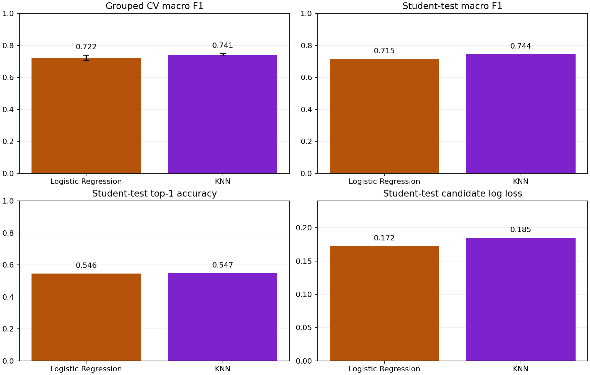
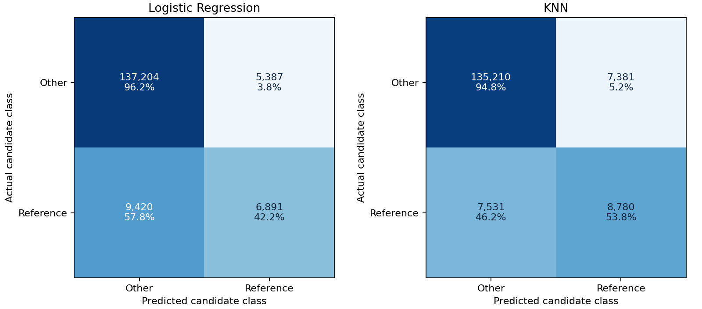
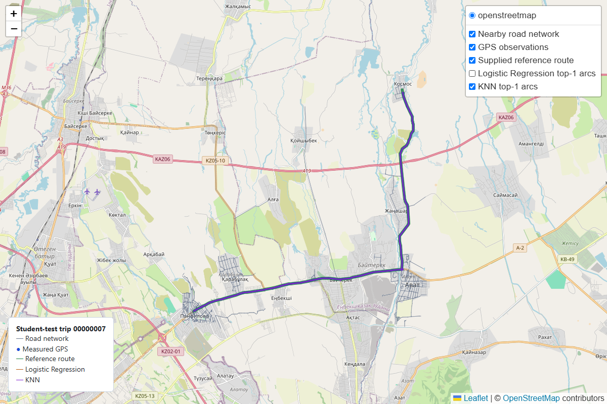

# PathSnap baseline experiments

Logistic Regression and KNN are two of the five required model experiments.
Both rank directed road-arc candidates for each GPS observation.

## Experiment design

- **Inputs.** Distance to arc, candidate distance rank, fraction along the arc,
  and distance from the directed arc's start. Fit standardization inside each
  fold. Arc IDs and reference-derived columns are excluded from the features.
- **Target.** A candidate is positive when its arc ID matches the aligned
  reference arc. Final fitting used 1,469,576 candidate rows from 161,955
  eligible observations across all 80 training trips. Each eligible observation
  has one positive. The labels are derived from the supplied reference routes.
- **Partitions.** Five folds grouped by training trip, shared by both models.
  Final models were refit on all training trips and evaluated on the ten
  student-test trips. [Fold assignments](cv_folds.csv) and
  [configuration](config.json) record the split, parameters, seed and versions.
- **Metrics.** Candidate classification metrics use aligned observations with
  a reference arc in the candidate set and a binary threshold of 0.5. Top-1
  accuracy uses all aligned observations, counting an absent reference arc as
  a miss. Equal scores are resolved by distance rank and then arc ID.
  Classifier-only continuity is the share of eligible adjacent predictions
  using the same arc or arcs whose directed endpoints connect. Pairs crossing
  a GPS gap, observation row break, or missing prediction are skipped. This
  adjacency metric can penalize valid travel through intermediate arcs.
- **Coverage.** Student-test has 16,317 aligned observations, including six
  candidate misses (0.037%). The remaining 2,822 ambiguous and 21 unmatched
  observations are excluded from accuracy metrics. Per-fold counts are in
  [metrics.csv](metrics.csv).

## Comparison

Grouped CV values are the mean across five held-out folds. The uncertainty on
macro F1 is the sample standard deviation across folds.

| Model | Family | Grouped CV macro F1 | Grouped CV top-1 | Student macro F1 | Student top-1 | Student log loss | Student continuity |
|---|---|---:|---:|---:|---:|---:|---:|
| Logistic Regression | Linear probabilistic | 0.722 ± 0.017 | 56.29% | 0.715 | 54.58% | 0.172 | 82.11% |
| KNN | Instance-based | 0.741 ± 0.007 | 55.50% | 0.744 | 54.70% | 0.185 | 82.04% |

| Model | Student candidate accuracy | Positive precision | Positive recall | Positive F1 | Final fit | Student scoring |
|---|---:|---:|---:|---:|---:|---:|
| Logistic Regression | 90.68% | 0.561 | 0.422 | 0.482 | 2.44 s | 0.039 s |
| KNN | 90.62% | 0.543 | 0.538 | 0.541 | 4.95 s | 11.94 s |

Timing is from one Windows run with thread pools capped at four threads.
Fitting includes standardization and model fitting. Scoring includes feature
array preparation and probability inference on 209,582 student-test candidate
rows. It excludes data loading, ranking, serialization and metric calculations.





Open the [interactive Folium map](student_test_map.html) locally for trip
`00000007`. Its toggleable layers show raw GPS, roads, the supplied reference
route, and each model's top-1 predicted arcs. The map is an offline development
evaluation artifact. The backend can use the score tables without the map or
reference labels.



## Logistic Regression

A linear model is interpretable and cheap to score for each candidate. We used
L2 regularization with `C=1`, the `lbfgs` solver, a 200-iteration limit, and
seed 42. The training objective is regularized binary logistic loss. The
predicted positive-class probability is the candidate score.

Student-test positive precision was 0.561 and recall was 0.422 at the 0.5
threshold. The model missed 9,420 positive candidates in the binary evaluation.
A single linear score can miss interactions between proximity and projection
position, and the threshold results show the sensitivity tradeoff. In-sample
macro F1 (0.721) was close to grouped CV (0.722) and student-test (0.715),
with little evidence of overfitting in these runs. The results alone do not
establish underfitting. Logistic Regression had the lower student-test log
loss and scored the batch in 0.039 s.

## K-Nearest Neighbors

KNN estimates match likelihood from the labels of nearby training examples
in standardized feature space. We used 31 Euclidean neighbors, uniform
votes, and a KD-tree. It stores the training examples and minimizes no
parametric training objective. For scoring, a candidate with `v` positive
neighbors receives `(v + 1) / 33`, so even unanimous votes yield a finite
log probability.

KNN improved grouped CV macro F1 and student-test positive recall over
Logistic Regression. Its student-test top-1 advantage was about 0.12
percentage points and the grouped CV top-1 ordering went the other way.
Candidate-level F1 and observation-level ranking therefore give different
comparisons. In-sample macro F1 was 0.782 versus 0.741 in grouped CV and 0.744
on student-test. In-sample neighbor queries can include the training row
itself, and the drop shows limited generalization of some local patterns.
Scoring took 11.94 s and the stored index makes the artifact larger.

Both runs use non-epoch-based estimators. The final model selection and Bayesian
search require the full five-model comparison. The continuity results above
cover classifier-only predictions.

## Reproduce and use the scores

From the repository root after preparing the candidate and label tables:

```sh
python -m pip install -r requirements/requirements-baselines.txt
python scripts/train_baselines.py
python scripts/visualize_baselines.py
python scripts/score_baseline.py experiments/baselines/logistic_regression.joblib data/processed/candidates_student_test.parquet data/processed/logistic_scores.parquet
```

Both committed `*_student_scores.parquet` files include one row per candidate
key (`split`, `trip_id`, `obs_id`, `arc_id`) and a `score` column. The file stem
identifies the model. Scores estimate the binary positive class for each
candidate independently, so they need not sum to one per observation. Join
to geometry and the complete observation timeline by keys. The same scorer
loads the trusted `knn.joblib` artifact with the pinned environment.

Implementation and verification were assisted by Codex. All results above
come from the recorded run.
