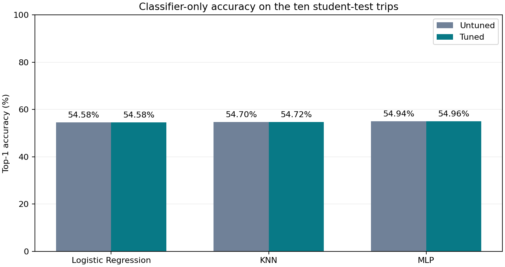
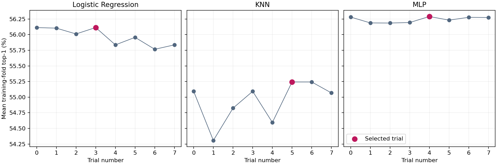

# Bayesian tuning for Logistic Regression, KNN, and MLP

## Protocol

We used Optuna's TPE sampler with seed 42 and eight trials per model, including
the original settings as trial zero. The first three trials initialize the
sampler. The objective is mean observation-level top-1 accuracy across three
folds grouped by trip. Each of the 80 training trips appears in one held-out
fold. Feature scaling is fitted only on eligible rows from the fitting trips
in each fold. Predictions break ties by candidate rank and arc ID.
Aligned observations with no reference candidate count as misses.

The search uses the same four geometric features as the published baselines.
After all three searches finished, we refitted each selected configuration on
the full training partition and evaluated it on the same ten student-test trips
as its original model. Search-fold results guide selection and should be read
as development scores. Student-test results provide the held-out comparison.
The student-test and evaluator splits played no role in parameter selection.

- [Trip assignments](search_folds.csv)
- [Seed, objective, and dependency versions](protocol.json)
- [Complete student-test comparison](student_test_comparison.csv)

## Search spaces

| Model | Settings searched |
|---|---|
| Logistic Regression | L2 inverse strength `C` from 0.001 to 100 on a log scale, positive-class weights 1, 2, 4, or 8 |
| KNN | 7, 15, 23, 31, 41, or 51 Euclidean neighbors, uniform or inverse-distance votes |
| MLP | Hidden layers 16×8, 32×16, or 48×24, 3, 5, 7, or 10 epochs, L2 coefficient 0.000001–0.01, learning rate 0.0003–0.003 |

KNN retrieves the same 51-neighbor pool for each search configuration and
votes over the first `k`. Both search and tuned inference use that rule.
The published KNN baseline queried exactly 31 neighbors. Exact ties at a
neighborhood boundary can therefore produce different results even with the
published settings. Inverse-distance votes use only the exact matches when
any of the selected neighbors has zero distance. Both vote types use the
same smoothing convention as the baseline. Repeated trial configurations
reuse their fold scores and are marked as cached in the trial logs.

## Held-out results

| Model | Untuned top-1 | Tuned top-1 | Change (pp) | Untuned macro F1 | Tuned macro F1 | Tuned log loss |
|---|---:|---:|---:|---:|---:|---:|
| Logistic Regression | 54.58% | 54.58% | +0.000 | 0.715 | 0.716 | 0.172 |
| KNN | 54.70% | 54.72% | +0.025 | 0.744 | 0.746 | 0.179 |
| MLP | 54.94% | 54.96% | +0.018 | 0.748 | 0.740 | 0.161 |

Logistic Regression had the same number of correct top-1 predictions. KNN and
MLP gained four and three correct observations, respectively, out of 16,317.
MLP had the highest top-1 accuracy of these three tuned runs, and its
candidate macro F1 fell from 0.748 to 0.740. KNN's macro F1 and log loss
both improved slightly. The small top-1 changes do not establish a
meaningful accuracy gain across trips.

## Selected settings

| Model | Selected settings | Training-fold top-1 before | Training-fold top-1 selected | Distinct settings |
|---|---|---:|---:|---:|
| Logistic Regression | C=68.5357, positive_weight=1 | 56.112% | 56.113% | 8 |
| KNN | n_neighbors=41, weights=uniform | 55.093% | 55.242% | 6 |
| MLP | shape=32x16, epochs=10, alpha=0.000232429, learning_rate=0.00223501 | 56.280% | 56.289% | 8 |





Top-1 uses aligned observations, including candidate misses. Candidate macro F1
and binary log loss use aligned observations with the reference arc in the
candidate set. There were six misses among 16,317 aligned student-test
observations. The CSV includes classifier-only continuity, precision, recall,
positive F1, candidate accuracy, and fit and inference times. These scores
are the inputs to the subsequent Viterbi comparison.

## Model artifacts

| Model | Search log and selection | Student-test evaluation | Model and scores |
|---|---|---|---|
| Logistic Regression | [Trials](logistic_regression/search_trials.csv) · [Selection](logistic_regression/selection.json) | [Metrics](logistic_regression/metrics.csv) | [Model](logistic_regression/logistic_regression.joblib) · [Scores](logistic_regression/logistic_regression_student_scores.parquet) |
| KNN | [Trials](knn/search_trials.csv) · [Selection](knn/selection.json) | [Metrics](knn/metrics.csv) | [Model](knn/knn.joblib) · [Scores](knn/knn_student_scores.parquet) |
| MLP | [Trials](mlp/search_trials.csv) · [Selection](mlp/selection.json) | [Metrics](mlp/metrics.csv) | [Model](mlp/mlp.joblib) · [Scores](mlp/mlp_student_scores.parquet) |

Each score export contains one estimated positive-class probability per
`split`, `trip_id`, `obs_id`, and `arc_id`. Use the full key to join it to the
candidate geometry. Keep all observations in the decoder timeline.
The individual binary probabilities need not sum to one within an observation.

## Reproduce

From the repository root with the processed data and raw archive in place:

```sh
python -m pip install -r requirements/requirements-classifier-tuning.txt
python scripts/tune_classifiers.py
python scripts/visualize_classifier_tuning.py
python scripts/score_baseline.py experiments/classifier_tuning/mlp/mlp.joblib data/processed/candidates_student_test.parquet data/processed/mlp_tuned_scores.parquet
```

Use `--output` for a new tuning run and `--results` for its plots so the recorded
trial logs and results remain available. Codex assisted with implementation
and verification. All reported values come from the recorded experiments.
