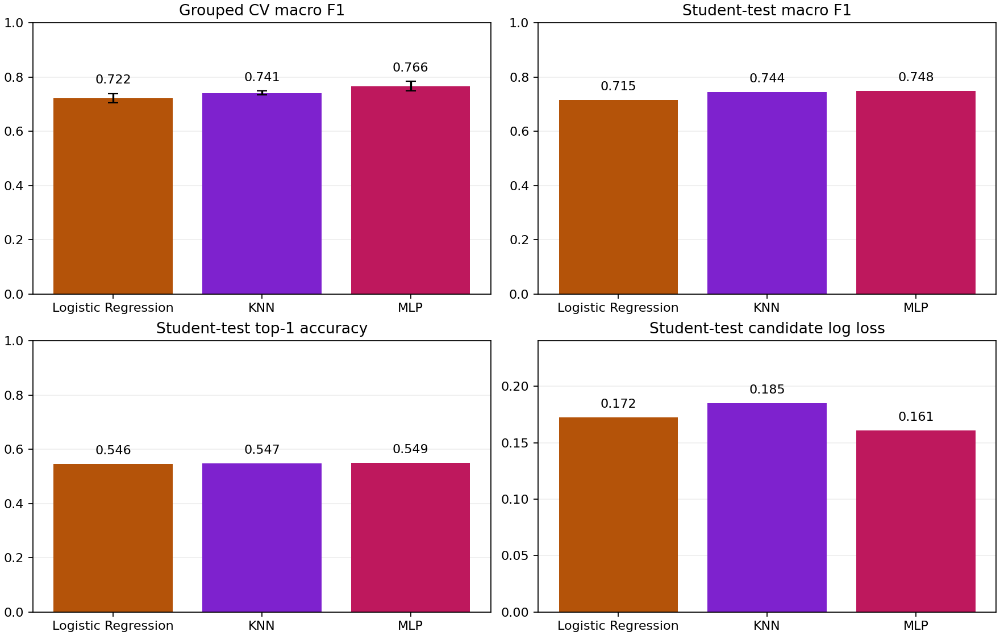
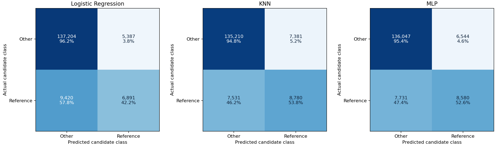
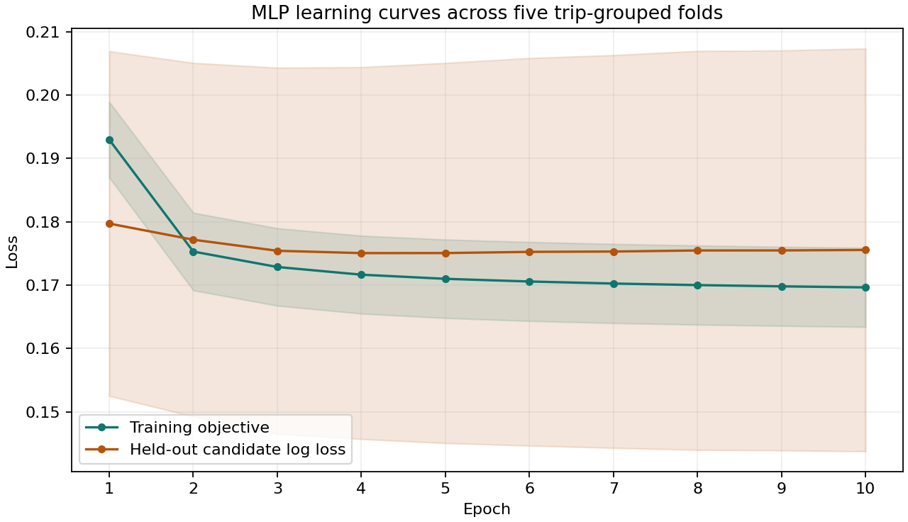
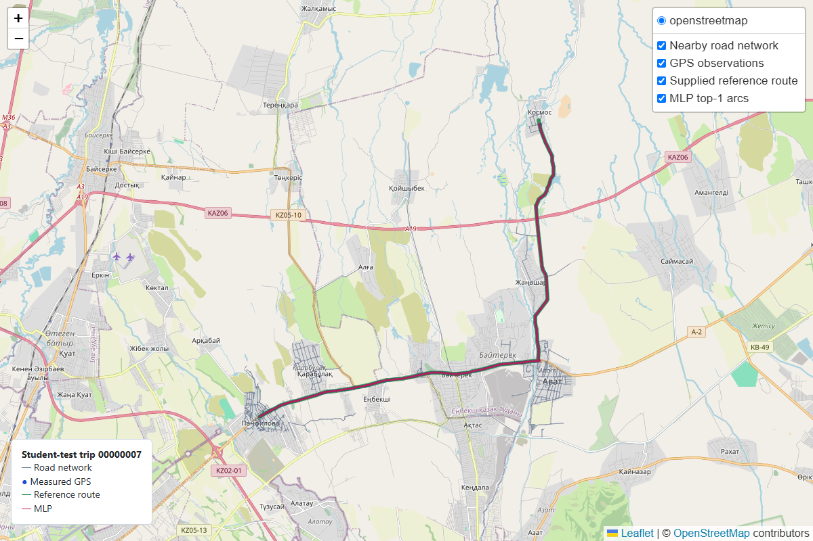

# PathSnap MLP experiment

The MLP is the neural-network entry in the five-model comparison. It scores
each candidate road segment for a GPS observation. Two ReLU hidden layers
let it learn nonlinear interactions among the same features used by the
Logistic Regression and KNN baselines. For example, the relevance of a
projection near an arc endpoint may depend on the GPS-to-arc distance.

## Data and configuration

- **Features.** GPS-to-arc distance, candidate rank, fractional position,
  and offset from the arc start. Fit the standard scaler within each training
  fold. Reference-derived columns are targets and evaluation metadata.
- **Target.** One positive candidate per eligible GPS observation, using
  the reference route alignment. Final fitting used 1,469,576 candidate rows
  from 161,955 observations across all 80 training trips.
- **Splits.** The model uses the [same five held-out trip folds](cv_folds.csv)
  as both baselines. The 10 student-test trips are evaluated after refitting
  on all training trips. Evaluator data is reserved for final evaluation.
- **Network.** Two hidden layers of 32 and 16 units, ReLU activations, Adam,
  learning rate 0.001, L2 coefficient 0.0001, batch size 1,024, and seed 42.
  Training uses binary log loss with L2 regularization. The experiment uses
  10 fixed epochs per fit with no early stopping or tuning.
  [Full configuration and dependency versions](config.json).

## Measured results

| Model | Grouped CV macro F1 | Grouped CV top-1 | Student macro F1 | Student top-1 | Student log loss | Student continuity |
|---|---:|---:|---:|---:|---:|---:|
| Logistic Regression | 0.722 ± 0.017 | 56.29% | 0.715 | 54.58% | 0.172 | 82.11% |
| KNN | 0.741 ± 0.007 | 55.50% | 0.744 | 54.70% | 0.185 | 82.04% |
| MLP | 0.766 ± 0.017 | 56.40% | 0.748 | 54.94% | 0.161 | 82.26% |

Grouped CV shows the fold mean and, for macro F1, the sample standard
deviation. See the [per-fold and student-test metrics](metrics.csv).
Continuity measures same-arc or directly connected consecutive predictions,
excluding GPS gaps, row breaks, and missing predictions. It is a
classifier-only metric and can miss connections through intermediate arcs.

The MLP achieved **91.02% candidate accuracy**, **0.567 positive precision**,
**0.526 positive recall**, and **0.546 positive F1** on the student-test
trips at a 0.5 threshold. Its confusion counts were 136,047 true negatives,
6,544 false positives, 7,731 false negatives, and 8,580 true positives.
Binary metrics use observations with an aligned reference arc present in
the candidate set. Top-1 also counts six candidate misses among 16,317
aligned observations. The other 2,822 ambiguous and 21 unmatched
student-test observations are excluded from these accuracy measures.

The final fit took **31.45 s**, including feature scaling. Scoring all
209,582 student-test candidates took **0.088 s**, including feature array
preparation. Both times are from one Windows run with thread pools capped
at four threads. Scoring excludes file I/O, ranking, and evaluation.





## Learning curves and interpretation



The chart shows actual [per-epoch logs](epochs.csv), averaged across the
five folds with one standard deviation shaded. The training objective is
the average minibatch loss reported during updates, including the L2 term.
Held-out loss is binary log loss evaluated with the end-of-epoch model.

Mean held-out loss fell from 0.1797 at epoch one to about 0.1751 at epoch
four. It reached 0.1756 at epoch ten while the training objective continued
to fall. This suggests diminishing validation gains and mild late-epoch
overfitting. The reported model retains the original 10-epoch schedule.
Its in-sample macro F1 was 0.757 versus 0.766 in grouped CV and 0.748 on
student-test. There is no clear evidence of a large generalization gap in
these experiments. The four geometry features offer limited information to
resolve parallel roads or direction ambiguity, which helps explain why the
higher candidate F1 produced only a small top-1 improvement over KNN.
Final model selection and Bayesian tuning follow the full comparison.

## Route visualization and score handoff

The [interactive Folium map](student_test_map.html) shows student-test
trip `00000007`, with toggleable GPS, road-network, reference-route and
MLP top-1 layers. It is a development report artifact. Reference data
stays outside the inference score export.



[Student-test scores](mlp_student_scores.parquet) carry one row per
`split`, `trip_id`, `obs_id`, and `arc_id`. The `score` is the MLP's
estimated positive-class probability for that candidate. These binary
probabilities need not sum to one within an observation. Use the original
observation timeline and candidate geometry when feeding scores to the decoder.

## Reproduce the experiment

```sh
python -m pip install -r requirements/requirements-baselines.txt
python scripts/train_mlp.py
python scripts/visualize_mlp.py
python scripts/score_baseline.py experiments/mlp/mlp.joblib data/processed/candidates_student_test.parquet data/processed/mlp_scores.parquet
```

[The fitted model](mlp.joblib) includes the training-fitted scaler. Use the
pinned environment to reload this trusted artifact. Codex assisted with
implementation and verification. The metrics and figures come from the
recorded run.
