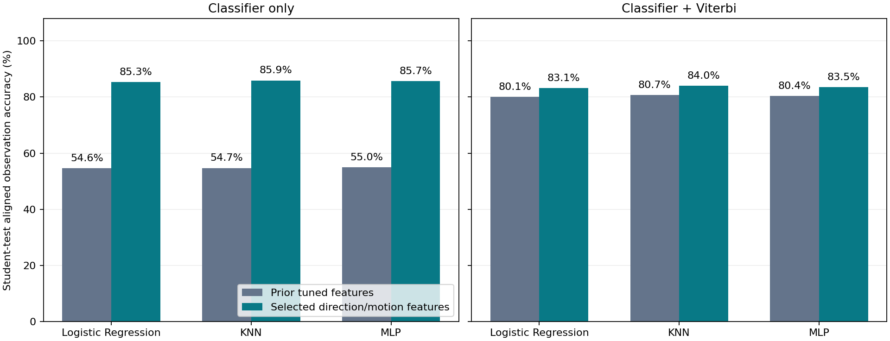

# Direction and movement experiments

This experiment records the earlier feature-development runs. See the
[submission comparison](../../README.md#model-comparison) for the delivered model results.

## Changes to the classifier inputs

The prior tuned models had four features from the geometry of one GPS reading.
This experiment keeps those inputs and tests two additional feature sets.

| Feature set | New inputs |
|---|---|
| Heading | Agreement between the candidate's directed bearing and the GPS displacement over up to the previous three observations. A value near +1 indicates forward motion and a value near −1 indicates the reverse direction. Movements shorter than 12 m are weighted down. |
| Heading and motion | Heading agreement plus signed movement along the candidate arc and log-transformed GPS speed. Project both the previous and current points onto the arc and compare their clamped offsets. Scale by GPS step length, using an 8 m floor. Clip speed to 65 m/s before applying `log1p`. |

The displacement window restarts at GPS gaps and missing observation rows.
Direction and projected progress are zero when motion history is unavailable.
A missing speed is represented as zero in this candidate feature. GPS records
are kept as measured. Motion only uses the current and earlier measurements.
The trip's median latitude sets the scale of the local metric coordinate
system. Only the GPS observations and directed graph are used to construct
these features. Candidate generation and reference alignment stay the same.

## Experiment design

- Reuse the [same three training-trip folds](search_folds.csv) from Bayesian
  tuning and rank settings by mean observation-level top-1. Fit standardization
  only on each fold's fitting trips. Test both feature sets before selecting
  a configuration. Student-test results are calculated after selection.
- Start with the previously tuned Logistic Regression and MLP parameters.
  Test Logistic Regression regularization/class weights and MLP epoch counts.
  KNN searches neighbor count and vote weighting using a shared fixed-size
  neighbor query. Its deterministic index draws 16,000 eligible observations
  from the fitting trips and retains all candidates for each sampled observation.
  Each fitting trip contributes at least one observation. The prior tuned KNN
  fit used the full eligible index, so its before/after comparison includes
  the index-size change as well as the new features.
- Refit the selected configurations on all 80 training trips using each
  model's fitting rule. Evaluate on the same 10 student-test trips. Use only
  aligned observations for accuracy and count a missing reference candidate
  as an incorrect prediction.
- Run the prior and enhanced score exports through the **same** Viterbi
  decoder settings (`beta_m=60`, `gap_seconds=10`, routing cache 20,000).
  These settings come from the existing training-only decoder calibration.
  Keep all GPS observations in the decoder timeline.

[Protocol and configurations](protocol.json) · [Fold-level results](validation_trials.csv) ·
[Selected settings](selection.json)

## Training-fold feature comparison

| Model | Prior tuned features | Best heading | Best heading + motion | Selected setting |
|---|---:|---:|---:|---|
| Logistic Regression | 56.11% | 84.06% | 83.25% | heading, C=1, positive_weight=2 |
| KNN | 55.24% | 84.06% | 84.48% | motion, n_neighbors=51, weights=uniform |
| MLP | 56.29% | 84.08% | 84.62% | motion, shape=32x16, epochs=5, alpha=0.000232429, learning_rate=0.00223501 |

For each feature set, the table shows the highest mean across the three folds.

## Student-test accuracy

| Model | Prior top-1 | Enhanced top-1 | Classifier gain | Prior + Viterbi | Enhanced + Viterbi | Decoded gain |
|---|---:|---:|---:|---:|---:|---:|
| Logistic Regression | 54.58% | 85.33% | +30.75 pp | 80.08% | 83.15% | +3.07 pp |
| KNN | 54.72% | 85.93% | +31.21 pp | 80.70% | 83.97% | +3.27 pp |
| MLP | 54.96% | 85.74% | +30.78 pp | 80.38% | 83.48% | +3.11 pp |



## Route continuity and breaks

| Model | Prior decoded continuity | Enhanced decoded continuity | Prior breaks | Enhanced breaks |
|---|---:|---:|---:|---:|
| Logistic Regression | 93.87% | 96.11% | 204 | 204 |
| KNN | 94.40% | 96.68% | 204 | 204 |
| MLP | 94.51% | 96.19% | 204 | 204 |

Continuity uses predictions on the same arc or on directly connected directed arcs,
excluding gaps, row breaks, and missing predictions. It can penalize valid movement
through intermediate arcs. Route breaks count restarts between decoded segments.

## Files and reproduction

- [Classifier metrics](metrics.csv) give top-1, macro F1, log loss, fit time,
  candidate coverage and classifier-only continuity.
- [Prior Viterbi by trip](viterbi_prior_per_trip.csv) and
  [enhanced Viterbi by trip](viterbi_enhanced_per_trip.csv) include top-1,
  Viterbi accuracy, continuity, route breaks, and timing for every test trip.
- The fitted models and candidate scores are in this directory. Each score
  export uses the original `split`, `trip_id`, `obs_id`, and `arc_id` keys.
  Each score estimates the positive class for that candidate. Reference labels
  are used for fitting and evaluation and stay outside the score files.

```sh
python -m pip install -r requirements/requirements-classifier-tuning.txt
python scripts/train_motion_models.py
python scripts/benchmark_motion_decoding.py
python scripts/visualize_motion_models.py
python scripts/score_motion_models.py experiments/motion_features/mlp.joblib data/processed/mlp_motion_scores.parquet
```

Codex assisted with implementation and verification. All results are from
the recorded experiments.
